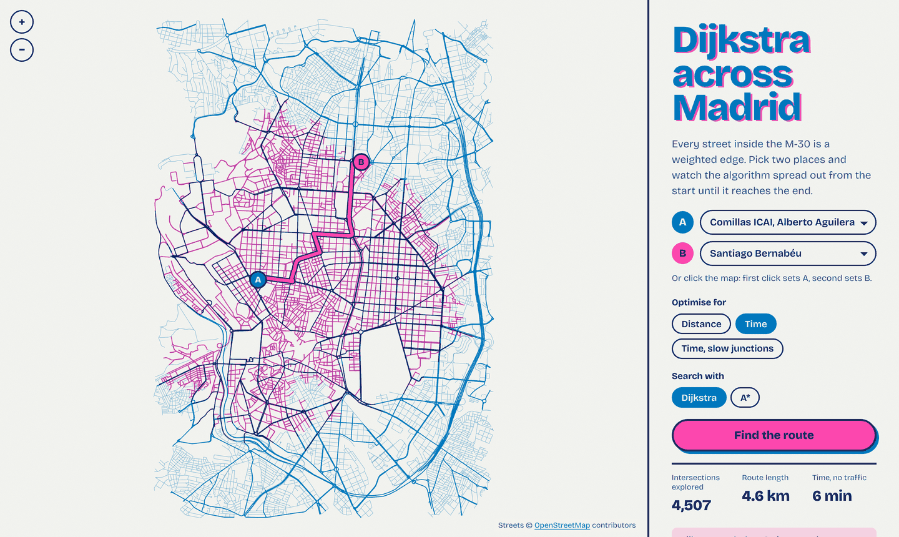
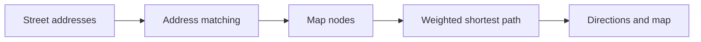

# GraphNav

**From weighted graphs to street navigation in Madrid.**

A Python coursework project connecting implementations of Dijkstra, Prim, and Kruskal with an interactive navigation prototype using OpenStreetMap data.

**[Try it in your browser →](https://liiiaamm.github.io/GraphNav/)** Pick two places in central Madrid and watch Dijkstra, or A*, search 12,106 intersections inside the M-30, then follow the turn-by-turn directions.

[](https://liiiaamm.github.io/GraphNav/)

## The browser version

The street graph is built from OpenStreetMap: every drivable way inside the M-30, with its one-way rules, speed limit and name, contracted so that each node is an intersection (`scripts/build_web_graph.py`, output `web/madrid.json`, 0.5 MB compressed). The page (`index.html`, `web/nav.js`) runs the same three weightings as `gps.py`:

- **Distance:** street length in metres.
- **Time:** length divided by the speed limit, or a default by road type (the `MAX_SPEEDS` table in `callejero.py`).
- **Time, slow junctions:** adds an expected 24 s (80 % × 30 s) at every intersection on a major road.

It also adds A*, with the straight-line distance (or straight-line time at the top speed) as the heuristic. On ICAI to the Bernabéu by time, Dijkstra settles 4,507 intersections and A* 2,058 for the same route; by distance, A* needs 732.

**A bug found on the way.** `aplicar_peso_rapido_sem` in `gps.py` looked for `"crossing"` in each edge's `highway` tag, but OpenStreetMap tags traffic signals and crossings on nodes, not ways. The penalty never applied, so the "with traffic lights" mode always returned the same route as the plain fast mode. The browser version applies the junction delay on nodes instead.

```bash
# rebuild the graph from an OpenStreetMap GeoJSON of Madrid
curl -LO https://raw.githubusercontent.com/amoraschi/spain-cities-geojson/master/cities/madrid.geojson
python scripts/build_web_graph.py madrid.geojson
python -m http.server   # then open http://localhost:8000
```

Street data © OpenStreetMap contributors, available under the Open Database License.

## Features

- Shortest-path trees and route reconstruction with Dijkstra.
- Minimum spanning tree / forest algorithms with Prim and Kruskal.
- Address matching, route selection, map visualization, and textual directions.
- Distance-based and estimated travel-time routing, including a traffic-signal variant.



## Try the graph algorithms

From the repository root, install NetworkX:

```bash
python -m pip install networkx==3.3
python test_grafo.py
```

The existing script prints results on a small graph with randomized weights; it is a demonstration rather than an assertion-based test suite.

```python
import networkx as nx
from grafo_pesado import camino_minimo

graph = nx.Graph()
graph.add_weighted_edges_from([("A", "B", 2), ("B", "C", 3), ("A", "C", 9)])
route = camino_minimo(graph, lambda g, u, v: g[u][v]["weight"], "A", "C")
print(route)  # ['A', 'B', 'C']
```

## Run the navigation prototype

Use Python 3.11 and install the original pinned dependencies in a virtual environment:

```bash
python -m venv .venv
# Activate .venv using the command for your shell.
python -m pip install -r requirements_gps.txt
python gps.py
```

The full application requires a local **`direcciones.csv`**, which is not included. The loader expects a semicolon-separated file encoded as ISO-8859-1 with `VIA_CLASE`, `VIA_PAR`, `VIA_NOMBRE`, `NUMERO`, `LATITUD`, and `LONGITUD` columns. See `callejero.py` for the expected coordinate format. Map acquisition also requires access to OpenStreetMap services when no local map is available.

Enter addresses in `Street,Number` format and choose `C`, `R`, or `RS`. The interface is in Spanish. Travel-time weights are estimates, without live traffic data.

## Repository map

| File | Purpose |
| --- | --- |
| `grafo_pesado.py` | Core graph algorithms |
| `callejero.py` | Address data, map loading, and visualization |
| `gps.py` | Interactive routing and directions |
| `test_grafo.py` | Small graph demonstration |
| `requirements_gps.txt` | Navigation dependencies |

## Context

Developed by **Liam Esgueva González and Sergio Fernández Cordero** for Discrete Mathematics at Comillas ICAI. This is an academic navigation prototype; the autonomous robot mentioned in Liam's CV is a separate project.
