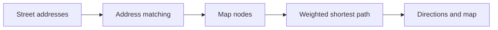

# GraphNav

**From weighted graphs to street navigation in Madrid.**

A Python coursework project connecting implementations of Dijkstra, Prim, and Kruskal with an interactive navigation prototype using OpenStreetMap data.

## Features

- Shortest-path trees and route reconstruction with Dijkstra.
- Minimum spanning tree / forest algorithms with Prim and Kruskal.
- Address matching, route selection, map visualization, and textual directions.
- Distance-based and estimated travel-time routing, including a traffic-signal variant.



## Try the graph algorithms

From the repository root, install NetworkX:

```bash
python -m pip install networkx==3.3
python test_grafo.py
```

The existing script prints results on a small graph with randomized weights; it is a demonstration rather than an assertion-based test suite.

```python
import networkx as nx
from grafo_pesado import camino_minimo

graph = nx.Graph()
graph.add_weighted_edges_from([("A", "B", 2), ("B", "C", 3), ("A", "C", 9)])
route = camino_minimo(graph, lambda g, u, v: g[u][v]["weight"], "A", "C")
print(route)  # ['A', 'B', 'C']
```

## Run the navigation prototype

Use Python 3.11 and install the original pinned dependencies in a virtual environment:

```bash
python -m venv .venv
# Activate .venv using the command for your shell.
python -m pip install -r requirements_gps.txt
python gps.py
```

The full application requires a local **`direcciones.csv`**, which is not included. The loader expects a semicolon-separated file encoded as ISO-8859-1 with `VIA_CLASE`, `VIA_PAR`, `VIA_NOMBRE`, `NUMERO`, `LATITUD`, and `LONGITUD` columns. See `callejero.py` for the expected coordinate format. Map acquisition also requires access to OpenStreetMap services when no local map is available.

Enter addresses in `Street,Number` format and choose `C`, `R`, or `RS`. The interface is in Spanish. Travel-time weights are estimates, without live traffic data.

## Repository map

| File | Purpose |
| --- | --- |
| `grafo_pesado.py` | Core graph algorithms |
| `callejero.py` | Address data, map loading, and visualization |
| `gps.py` | Interactive routing and directions |
| `test_grafo.py` | Small graph demonstration |
| `requirements_gps.txt` | Navigation dependencies |

## Context

Developed by **Liam Esgueva González and Sergio Fernández Cordero** for Discrete Mathematics at Comillas ICAI. This is an academic navigation prototype; the autonomous robot mentioned in Liam's CV is a separate project.
